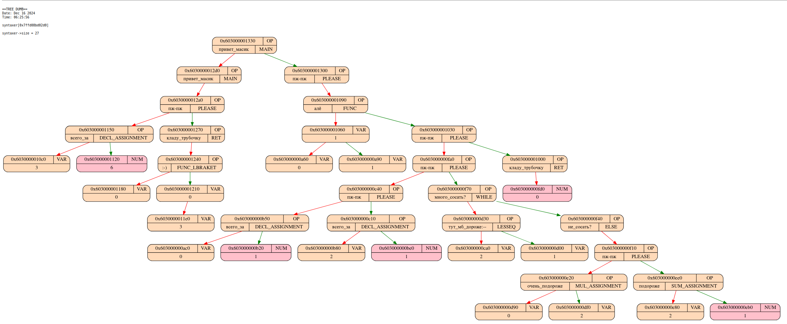

---
author:
- Попов Владимир Сергеевич, Б01-411, 1 курс ИВТ ФРКТ МФТИ
title: |
  Написание собственного бинарного транслятора
---

# Masik - язык для блондинок

Это реализациия бинарного транслятора собственного языка в nasm / собственный ассемблер / elf. 

**Этапы трансляции:**

- Фронтенд. Построение AST рекурсивным спуском.
- Мидленд. Построение собственного IR
    - Свёртка констант и тривиальных выражений. Проводится над AST.
    - Dead-code-elimination, kill unused variables
- Бэкенд
    - Трансляция IR в исполняемый elf-файл
    - Трансляция IR в nasm x86-64
    - Трансляция IR в собственный ассемблер
- (опционально) Запуск собственного функционального симулятора / компиляция nasm

## Зависимости

| Зависимость           | Минимальная версия    | Назначение                                    |
|-----------------------|-----------------------|-----------------------------------------------|
| **Make**              | 4.3                   | Сборка проекта и зависимостей                 |
| **gcc**               | 11.4                  | Компиляция C кода                             |
| **сигареты**          | 3.0.1                 | Импотенция                                    |
| **ld**                | 2.38                  | Линковка asm                                  |
| **nasm**              | 2.15                  | Компиляция сгенерированного asm x86-64        |
| **graphviz**          | 2.43                  | Генерация дампа для AST                       |
| **SDL2**              | 2.0.20                | Видеопамять функционального симулятора        |
| **SDL2_TTF**          | 2.0.18                | Видеопамять функционального симулятора        |

В проекте используется несколько других всопомгательных репозиториев, они подключены как сабмодули. Все они лежат в папке libs. Чтобы посмотреть описание их работы перейдите в соответствующий репозиторий и прочитайте README.md.

## Использование

```bash
$ git clone https://github.com/kzueirf12345/masik.git
$ git submodule update --recursive
$ make [COMMAND] [OPTS]
```

Каждый этап трансляции можно запустить отдельно, и каждый из них можно собрать / пересобрать /запустить / очистить логи, этим действиям соответствуют постфиксы ```MODULE_build```, ```MODULE_rebuild```, ```MODULE_start```, ```MODULE_clean```. Есть следующие модули

--------------
MODULE | Переменная для опций | Описание
----|----|-----
frontend | FOPTS | Токенезирует текст программы ```-i [FILE=input.msk]```  строит AST представление рекурсивным спуском. Выводит его в preorder порядке в ```-o [FILE=front_out.txt]```
midlend | MOPTS | Считывает AST из ```-i [FILE=front_out.txt]```, сворачивает константы и тривиальный выражения. Строит IR и выводит его в ```-o [FILE=midle_out.pyam]```
midlend2 | MOPTS | Считывает IR из ```-i [FILE=midle_out.pyam]```, строит CFG, проводит оптимизации dead-code-elemination и kill-unused-variables. Выводит итоговый IR в ```-o [FILE=midle2_out.pyam]```
backend | BOPTS | Считывает IR из ```-i [FILE=midle2_out.pyam]```, преобразует его в nasm / собственный ассемблер / генерирует elf. Результат записывает в ```-n [FILE=masik_nasm.nasm]``` / ```-s [FILE=back_out.asm]``` / ```-e [FILE=masik_elf.out]```
splu | SAOPTS (ассемблирование), SPOPTS (процессинг) | Запускает функциональный симулятор, флаги и использование прописаны в README соответствующего репозитория
libs | - | Собирает библиотеки, ```libs_start``` нет
nasm | - | Генерирует исполняемый файл ```ASM_FILENAME.out``` из ассемблера ```ASM_FILENAME.nasm```. Также генерирует листинг ```ASM_FILENAME.lst```

Также есть более удобные общие команды

| Название | Описание |
| :--- | :--- |
| **all** | libs_build, frontend_all, midlend2_build, midlend_all, midlend2_start, backend_all, splu_all, nasm_all, elf_all |
| **all_elf** | libs_build, frontend_all, midlend2_build, midlend_all, midlend2_start, backend_all, elf_all |
| **all_nasm** | libs_build, frontend_all, midlend2_build, midlend_all, midlend2_start, backend_all, nasm_all |
| **all_splu** | libs_build, frontend_all, midlend2_build, midlend_all, midlend2_start, backend_all, splu_all |
| **build** | libs_build, frontend_build, midlend2_build, midlend_build, backend_build, splu_build |
| **start** | frontend_start, midlend_start, midlend2_start, backend_start, splu_start, nasm_build, nasm_start, elf_start |
| **rebuild** | libs_rebuild, frontend_rebuild, midlend2_rebuild, midlend_rebuild, backend_rebuild, splu_rebuild, nasm_clean, elf_clean |

Также ко всем модулям подключён логгер, чтобы указать папку логирования нужно использовать флаг ```-l [FOLDER=./log/]```.

## Грамматика

```bnf
<start> ::= (<func>)* <main> (<func>)* <END>

<func> ::= "алё" <NAME> ":-)" <vars>? ";-)" <body>
<main> ::= "привет_масик" <body>
<vars> ::= <NAME> ("ещё" <NAME>)*

<statement> ::= <if> | <while> 
             | ((<declaration> | <assignment> | <ret> | <sysfunc_void>)? ("пж-пж")+)

<assignment> ::=  <NAME> 
        ("всего_за" 
        |       "подороже" |       "подешевле" 
        | "очень_подороже" | "очень_подешевле" 
        |       "подороже_что_пиздец"
        ) 
        <expr> 

<expr> ::= <compare_eq>
<compare_eq> ::= <compare> (("близняшки" | "какашки") <compare>)*
<compare> ::= <sum> 
    (
        (    "тут_дороже:--" |    "тут_мб_дороже:--" 
        | "--:тут_дороже"    | "--:тут_мб_дороже"
        ) 
        <sum>
    )*
<sum> ::= <mul> (("плюс_вайбик" | "минус_вайбик") <mul>)*
<mul> ::= <pow> (("звёздочка" | "очень_минусик") <pow>)*
<pow> ::= <brackets> ("очень_звёздочка" <pow>)*
<brackets> ::= ":-)" <expr> ";-)" | <var_num_func>
<var_num_func> ::= <NUM> | <call_func> | <NAME>

<call_func> ::= <NAME> ":-)" <args>? ";-)"
<args> ::= <expr> ("ещё" <expr>)*
<ret> ::= "кладу_трубочку" <expr>

<sysfunc_void> ::= <out> | <in>
<out> ::= "снять_денюжки" ":-)" <args> ";-)"
<in> ::= "положить_денюжки" ":-)" <args> ";-)"

<declaration> ::= "купи" <NAME> ("всего_за" <expr>)?

<if> ::= "сосать?" <condition> <body> (<else>)?
<while> ::= "много_сосать?" <condition> <body> (<else>)?

<else> ::= "не_сосать?" <body>
<condition> ::= "туть" <expr> "и_туть"
<body> ::= "сосать" (<statement>)* "кончать"

```

Пример факториала и фибоначи можно посмотреть в файле ```assets/input.msk```

## AST

В случае ошибки на этапе работы с AST генерируется дамп дерева. Вот пример, того как он выглядит



## IR

| Default name | PYAM name | Return value | Label | Operation | First Operand | Second Operand |
| :--- | :--- | :--- | :--- | :--- | :--- | :--- |
| Call function | RingRing | Tmp | Function label | None | None | None |
| Function body | Gyat | None | Function label | None | Number of arguments | Number of local vars |
| Conditional jump | Frog | None | Local label | None | Tmp or Num | None |
| Assignment | Gnoming | Tmp or Var or Arg | None | None | Tmp or Var or Arg | None |
| Operation | Digging | Tmp | None | Operation | Tmp | Tmp |
| Label | Viperr | None | Local label | None | None | None |
| Return | Cherepovec | Tmp | None | None | None | None |
| Call sys function | Boob | Tmp | Sys func name | None | None | None |
| Global vars num | Gg | None | None | None | Number of arguments | None |
